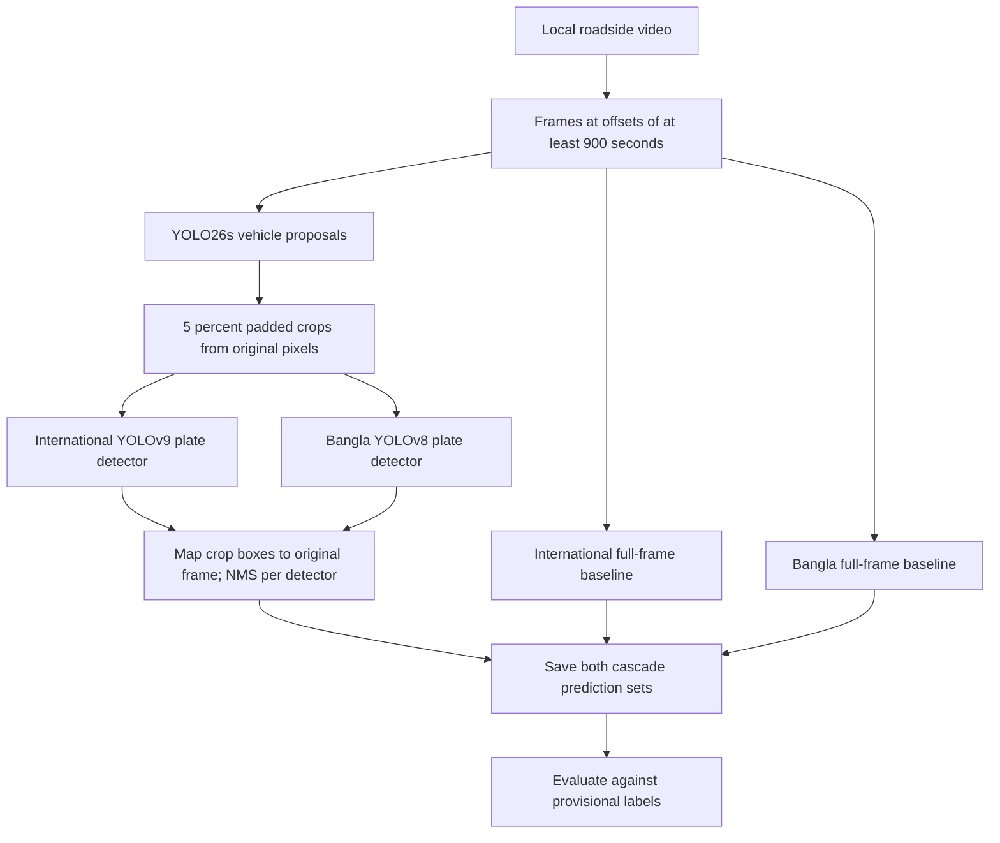
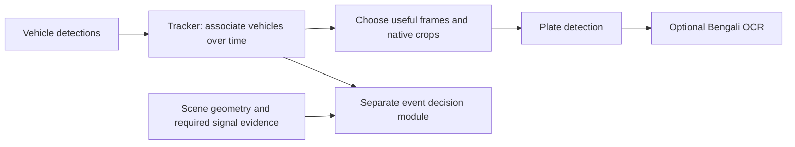

# A better model for Dhaka City — architecture and research guide

This guide describes the local pilot as implemented on 2026-10-10. Read `../progress.md` for current ownership and newer session results. Read `../AGENTS.md` before editing shared files. Workspace: `/Volumes/Projects/A better model for Dhaka City`.

## 1. What we are trying to achieve

Locate physical motor-vehicle number plates in crowded Dhaka roadside footage. The immediate output is a bounding box and confidence score for each detected plate. The user’s aspiration is above 85% and eventually 95%; we currently interpret this as detection recall and always report precision alongside it. A confidence threshold of 0.95 does not mean 95% accuracy.

We are using pretrained models to establish a baseline before deciding what needs fine-tuning. No model has been trained on this footage. No Bengali characters are being read. A physically identifiable but unreadable plate may still be a valid detection target.

The broader user goal includes Bengali plate recognition and traffic violations. Those are future modules; the current task is plate detection. The first 900 seconds of this video are excluded because they contain a protest.

## 2. Status: what exists and what is proposed

| Component | Status | Evidence / entry point |
| --- | --- | --- |
| Post-15-minute frame sampling | Done, 66 frames | `detection-pilot/frames/`, sample manifest and check protocol |
| Vehicle proposals and native-resolution crops | Implemented and run | `detection-pilot/run_detection.py`, `Pipeline.vehicles` |
| International and Bangla plate detectors | Both run on full frames and vehicle crops | `Pipeline.plates`, `predictions.jsonl` |
| Baseline evaluation | Done on 12 provisionally annotated development frames | `evaluate.py`, `metrics.csv` |
| Class-switch hybrid | Selected using a development diagnostic | `../work/detection-pilot/calibrate.py`, `check_protocol.json` |
| Reusable hybrid export / inference command | Pending | Must reproduce diagnostic ordering before optimization |
| Six fresh-timestamp evaluation | Predictions done; labels and scoring pending | `check_protocol.json` |
| Annotated demo / comparison report | Pending | Do not describe it as already delivered |
| Tracking, OCR, violations, training | Not run or evaluated | Future architecture only |

## 3. Implemented comparison pipeline



The comparison deliberately runs both plate detectors on every retained vehicle crop. It also runs each plate detector directly on the full image as an ablation. This lets us compare model choice and the benefit of cropping separately, using identical source pixels and vehicle proposals.

### Why original-resolution vehicle crops matter

A 4096-pixel-wide frame compressed into a 608-pixel plate-detector input can make a small plate only a few pixels wide. Cropping a vehicle first lets its plate occupy more of the input. The crop is cut from the original frame, not from the resized vehicle-detector tensor. Resizing cannot recover detail that was absent from the camera image.

The cascade introduces another failure mode: if the vehicle proposal misses a vehicle or cuts off its plate, the plate detector never receives that region. Separate proposal coverage, plate localization and final precision/recall when diagnosing errors. Do not call proposal coverage vehicle-detector accuracy.

### Exact current settings

| Stage | Settings |
| --- | --- |
| Vehicle detector | `yolo26s.pt`; image size 1280; `rect=False`; confidence 0.20; NMS IoU 0.50 |
| Vehicle classes | COCO IDs 1, 2, 3, 5, 7: bicycle, car, motorcycle, bus, truck |
| Cropping | Add 5% of box width/height on each side; clamp to image bounds; discard crops narrower or shorter than 32 pixels |
| International plate model | `international-yolov9.onnx`; fixed 608×608 input; embedded NMS; retain returned scores ≥0.10 |
| International preprocessing | Preserve aspect ratio, letterbox with value 114; BGR to RGB; CHW float32 scaled to [0,1]; undo padding and scale after inference |
| Bangla plate model | `bangla-yolov8.pt`; image size 608; `rect=False`; confidence 0.10; NMS IoU 0.50 |
| Cascade output | Add crop origin to plate coordinates; global NMS at IoU 0.50 separately for each plate model |
| Runtime used | CPU, four PyTorch threads; international ONNX Runtime CPU with four intra-op threads |

COCO has no dedicated CNG/autorickshaw class. Bicycle proposals may include rickshaw-like objects. The class-switch rule below therefore relies on imperfect predicted classes, not verified vehicle identities. This is a source of uncertainty to measure.

## 4. Selected hybrid: exact meaning and reproduction

The current candidate uses Bangla-model detections associated with motorcycle/bicycle proposals and international-model detections associated with all other retained vehicle classes. This was selected empirically on the development sample. It is not evidence that one model is universally best for that vehicle type.

To reproduce the reported development diagnostic from one saved prediction record:

```python
small_vehicle_classes = {"motorcycle", "bicycle"}
selected = [
    d for d in row["predictions"]["international_cascade"]
    if row["vehicles"][d["vehicle_index"]]["class"] not in small_vehicle_classes
] + [
    d for d in row["predictions"]["bangla_cascade"]
    if row["vehicles"][d["vehicle_index"]]["class"] in small_vehicle_classes
]
selected = nms(selected, threshold=0.5)
# evaluate() then applies confidence >= 0.35 and the evaluation ROI.
```

**Ordering matters:** saved cascade outputs already underwent global NMS per model. The diagnostic filters by source vehicle class afterward, merges the remaining boxes, and applies NMS again. A faster implementation that runs only one chosen detector per crop changes this ordering and may change results when vehicle crops overlap. Treat that optimization as a new variant and compare its predictions before claiming equivalence.

The frozen check uses confidence 0.35, matching IoU 0.50, and ROI `[0,500,3600,2824]`. Do not change these settings after seeing check outcomes. The hybrid still needs a clean reusable implementation and separately saved metrics.

A naive union of both detectors increased development recall but also produced many false positives. Overlapping image tiling was also tried and not selected for the first version. Keep their results as diagnostics, not as extra production branches.

## 5. Data contracts and coordinates

All saved boxes use original-frame pixel coordinates `[x1,y1,x2,y2]`, origin at the top left; x increases rightward, y downward. Frames are 4096×2824. These are not normalized YOLO training coordinates.

`predictions.jsonl` has one JSON object per sampled frame:

- `file`, `time_seconds`, `image_size`: frame filename, offset into source video, and `[width,height]`.
- `vehicles`: original `box`, integer `crop_box`, vehicle confidence/class, and `track_id` (null in current runs).
- `predictions`: `international_fullframe`, `international_cascade`, `bangla_fullframe`, `bangla_cascade`.
- A plate prediction contains `box` and `confidence`; cascade predictions also contain `vehicle_index` and null `track_id`. `vehicle_index` indexes this frame’s `vehicles` array and is not a persistent identity.
- `timings` and backend/device fields document how the result was generated.

Development `annotations.json` contains a global `region_xyxy`, frame filenames, `boxes_xyxy` for included plates and `ignore_xyxy` for ambiguous/excluded regions. Preserve its review log. Do not regenerate it using older scratch scripts; those predate label corrections.

`sample_manifest.json` lists the original 60 frames and 12 development annotation times. The additional six times are in `check_protocol.json`; the manifest has not yet been consolidated. An agent should explicitly preserve that distinction when documenting provenance.

## 6. Evaluation and the meaning of 85% / 95%

Current development set: 12 frames, 102 plate appearances. Labels were visually drawn and reviewed by an agent, not independently adjudicated by a human. Repeated stopped vehicles mean these are not 102 independent vehicles.

The evaluator keeps predictions whose centers fall in ROI `[0,500,3600,2824]`. It sorts predictions by confidence and greedily matches each to the highest-IoU unmatched labeled plate. IoU is intersection area divided by union area. A match needs IoU ≥0.50. Unmatched predictions whose centers lie inside an ignore region are ignored; other unmatched predictions are false positives. Unmatched labels are false negatives.

- Precision = TP / (TP + FP): how many reported detections are correct.
- Recall = TP / (TP + FN): how many labeled plate appearances are found.
- F1 = harmonic mean of precision and recall.

The current ROI score does not measure recall across the entire image. Ignore rules exclude ambiguous, heavily occluded or boundary-truncated plates, dealer placeholders, painted duplicate registration marks and municipal bicycle-rickshaw tags as documented in the labels. Review this policy before drawing conclusions about all real-world traffic.

| Development method | Confidence | TP / FP / FN | Precision | Recall |
| --- | --- | --- | --- | --- |
| International full frame | 0.25 | 33 / 2 / 69 | 94.3% | 32.4% |
| International vehicle crops | 0.25 | 82 / 15 / 20 | 84.5% | 80.4% |
| Bangla full frame | 0.25 | 2 / 16 / 100 | 11.1% | 2.0% |
| Bangla vehicle crops | 0.25 | 83 / 27 / 19 | 75.5% | 81.4% |
| Selected class-switch hybrid | 0.35 | 87 / 16 / 15 | 84.5% | 85.3% |

Baseline rows are in `detection-pilot/metrics.csv`; the hybrid is a development diagnostic. Neither establishes 95% performance. The hybrid does not reach 85% precision even on this development sample.

The fresh check uses offsets **975, 1155, 1335, 1515, 1695, 1875 seconds**. Complete its labels without model overlays, then score the frozen rule. It is a same-camera, same-session timestamp check; stopped vehicles can overlap development. Do not call it an independent vehicle/camera test.

For a stronger eventual claim, collect human-reviewed labels from disjoint recording sessions or cameras, keep near-duplicate frames and vehicle appearances together when splitting, tune only on training/validation data, and report on a locked test set. Predeclare both recall and an acceptable precision target. Break down errors by plate size, vehicle type, lighting and occlusion. This is the proposed next research protocol, not work already completed.

## 7. Where additional models fit later



A tracker links detections across frames; it does not itself determine a traffic violation. Plate detection localizes a plate; OCR reads characters. Future temporal aggregation could select sharp, large, unobstructed plate views. OCR would need its own exact-plate and character-level evaluation and an unreadable/abstain outcome.

A future red-light decision would need reliable signal state, a defined stop line and a tracked crossing at the relevant time. A future helmet module would need rider/head observations and temporal association. Neither is implemented here. Optional tracker code in `Pipeline.vehicles(track=True)` has not been run or validated in this pilot.

SAM3/segmentation and image restoration were research topics, not dependencies of the selected pilot. No generated or restored characters should be treated as observed plate evidence. See `plate-recovery-literature-review-2026-10-10.md` for the existing literature discussion; this guide is a description of our local implementation, not a new field-wide ranking.

## 8. Bounded tasks for the other agent

Claim a task in `../progress.md` first. These tasks are proposed assignments; no agent has been launched automatically.

| Task | Suggested owned output | Acceptance condition |
| --- | --- | --- |
| Fresh-check annotation | `teammate/check_annotations_draft.json` plus review notes | Six specified frames; original coordinates, clear ignore policy, no model overlays used while labeling |
| Reusable hybrid selector | `teammate/hybrid_selector.py` | Reproduces the diagnostic’s ordering and 87/16/15 development counts; handles empty inputs and duplicate boxes |
| Evaluation checks | `teammate/evaluation_checks.py` | Verify exact matches, duplicate predictions, missing plates, confidence cutoff, ROI and ignore behavior |
| Error audit | `teammate/error_audit.md` | Distinguish missed vehicle crop, missing plate detection, localization error, spurious text/sign and label ambiguity |
| Data expansion plan | `teammate/dataset_plan.md` | Session/camera split strategy; review budget; useful hard negatives; explicit test-set protection |

Integrate into `detection-pilot/` only after coordinating with its current owner. Keep model weights and raw footage local. Do not start a large training run merely because training is a future step.

After the frozen check, likely improvement work is targeted labeling of small motorcycle plates, green CNG plates and confusing painted text/signs, followed by controlled fine-tuning and comparison with the frozen pretrained baseline. Whether training is worthwhile should follow the error audit. More unlabeled gigabytes alone do not establish better detection performance.

## 9. Running and preserving the work

```sh
cd '/Volumes/Projects/A better model for Dhaka City'
YOLO_CONFIG_DIR="$PWD/work/detection-pilot/config" work/detection-pilot/.venv/bin/python outputs/detection-pilot/run_detection.py --device cpu
YOLO_CONFIG_DIR="$PWD/work/detection-pilot/config" work/detection-pilot/.venv/bin/python outputs/detection-pilot/evaluate.py
```

The first command skips filenames already in `predictions.jsonl`; no rerun is needed for the existing 66 frames. This simple resume mechanism does not detect changed weights/settings. For new experiments, use separate output files/directories and record model hashes/settings instead of silently mixing runs. The second command overwrites baseline metrics and does not evaluate the hybrid or fresh check.

Original weights, runtime versions and source links are documented in `../collaboration/codex/HANDOFF.md`. CPU timings mix ONNX and PyTorch backends and should not be presented as a controlled architecture speed ranking. No real-time deployment claim has been established.

Update `../progress.md` with files changed, checks performed, actual results, remaining work and ownership before ending your session.
